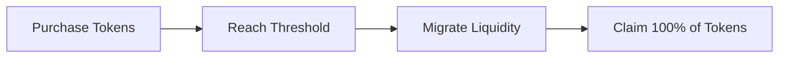

RugFreePump supports two token sale models: **Token Unlocked (TU)** and **Token Locked (TL)**. Both models operate within the same high-conviction bonding curve fundraising environment on Solana. 

The primary difference lies entirely in **how and when purchased tokens become available to buyers after a successful liquidity migration** to Raydium CPMM.

---

## Model Comparison

The creator selects the sale model during token creation. This selection becomes a **permanent, immutable on-chain configuration** that cannot be changed later.

| Feature | Token Unlocked (TU) | Token Locked (TL) |
| :--- | :--- | :--- |
| **Fundraising Mechanism** | Bonding Curve | Bonding Curve |
| **Token Delivery During Purchase** | Retained in protocol custody | Retained in protocol custody |
| **Allocation Record** | Tracked On-Chain | Tracked On-Chain |
| **Claiming Milestone** | Begins after successful migration | Begins after successful migration |
| **Release Velocity** | **100% immediate** release | **Gradual release** via fixed schedule |
| **Protocol Fees** | Identical | Identical |

---

## Core Mechanics

### 1. Token Unlocked (TU)
The TU model offers a straightforward progression designed for immediate post-migration access:

* **Immediate Control:** Once liquidity migration completes successfully, **100% of the buyer's purchased allocation becomes claimable**.
* **No Waiting Periods:** There are no lockups or gradual distribution restrictions post-launch.

### 2. Token Locked (TL)
The TL model releases tokens progressively based on fixed parameters established at protocol deployment. 

<Note>
  **Important:** Protocol administrators may adjust default settings for future sales, but active or completed sales retain their historical setup immutably.
</Note>

#### Current Protocol Release Schedule
Newly launched TL sales operate under the following protocol defaults:

* **Initial Unlock Unlock Interval:** 5.00% every 30 minutes.
* **Schedule Trigger:** Begins immediately after successful liquidity migration.
* **Full Liquidity Maturation:** 100% availability reached exactly 10 hours after migration.

#### Unlock Progress Matrix
Below is an example of an allocation totaling **100,000 tokens** under active TL parameters:

| Time After Migration | Incremental Unlock % | Total Tokens Available to Claim |
| :--- | :--- | :--- |
| **Immediately** | 0% | 0 tokens |
| **30 minutes** | 5% | 5,000 tokens |
| **1 hour** | 10% | 10,000 tokens |
| **2 hours** | 20% | 20,000 tokens |
| **5 hours** | 50% | 50,000 tokens |
| **10 hours** | 100% | 100,000 tokens |

---

## Shared Protocol Rules

Regardless of the model chosen by the creator, the following foundational rules apply to all sales across the network:

### Custody & Claiming Transactions
* **Manual Claims Required:** Tokens are never automatically pushed to wallets. Buyers must manually initiate the claim transaction via the portal UI.
* **Gas Fees:** RugFreePump charges **0% additional protocol fees for claiming**; however, buyers must cover standard Solana network transaction and token account creation fees.
* **Batching Claims:** TL buyers are not required to claim every 30 minutes. Unclaimed allocations accumulate continuously and can be pulled in a single transaction at any time.

### Protection & Expiration Rules
* **Incomplete Sales:** If a bonding curve expires without meeting its fundraising target, or if a finalized sale is terminated via authorized emergency protocols, users can safely withdraw their contributed SOL according to system guidelines.
* **Migration Milestone Dependency:** Reaching the fundraising threshold changes a sale's state to *Completed*, but claiming parameters only unlock once the underlying *liquidity migration transaction successfully confirms* on-chain.

---

## Strategic Guidelines

### For Creators
* **When to select TU:** Best for projects seeking immediate market float, simple claiming logic, and uninhibited trading actions. Note that this can cause concentrated sell pressure right at launch.
* **When to select TL:** Best for projects seeking structured token distribution mechanics that match longer-term community milestones. Note that gradual unlocks do not prevent volatility or eliminate general market sell pressure.

### For Buyers
* **Review Before Buying:** Always inspect the token's metadata flag via the UI to check if it is running on a TU or TL framework before allocating SOL.
* **Value Disclaimer:** On-chain distribution architecture dictates token *availability*, not asset value. Neither model guarantees price appreciation, market liquidity, or project sustainability.
